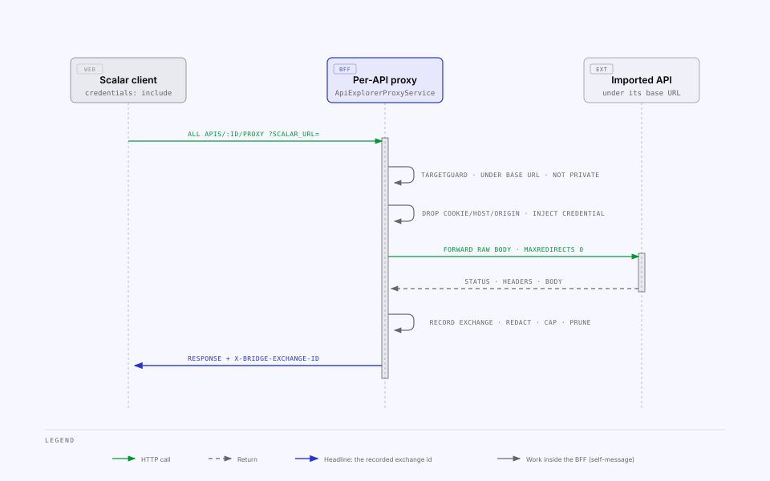
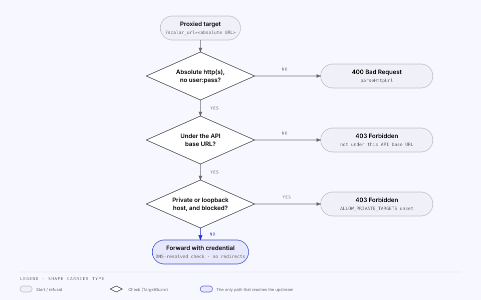

<!-- Generated from the MILS Bridge source repository (docs/integrations/api-explorer.md). Edit it there, not here. -->

# API Explorer — any OpenAPI-described API as a source

Console users import **any HTTP API described by an OpenAPI document**, explore
it inside the console with the [Scalar API client](https://github.com/scalar/scalar),
and register the responses worth keeping as MILS Items. Every request the client
sends goes through a per-API proxy on the BFF, which injects the API's stored
credential and records the exchange; the recorded exchange is what gets
registered. It is the one integration with user-created instances, so the
registry entry stands for all imported APIs and has an empty settings slice.

```
Create   /api-explorer → New API → import (URL · paste · file) → base URL + auth → create
Use      /api-explorer/:apiId → Scalar client → send requests
         → Requests tab → open one → Register into MILS
         → ResourceMapping (kind api-exchange) + MilsItemPayload = the exchange
```

## How it fits together

| Piece               | Where                                                                              | Notes                                                                                                                    |
| ------------------- | ---------------------------------------------------------------------------------- | ------------------------------------------------------------------------------------------------------------------------ |
| Registry entry      | `INTEGRATIONS['api-explorer']` in `packages/shared/src/integrations.ts`            | Role `source`, kind `api-exchange`, `browsePath: '/api-explorer'`, empty settings slice                                  |
| An imported API     | `ApiIntegration` row                                                               | Name, **base URL**, normalised OpenAPI **3.1 JSON**, credential (`authType` + write-only `authSecret`), `captureEnabled` |
| A recorded exchange | `ApiExchange` row                                                                  | Method, URL/path/query as sent, redacted headers, capped bodies, status, duration, who sent it. Cascades with its API    |
| Cross-reference     | `ResourceMapping` with `concoreKind = 'api-exchange'`, `concoreId = <exchange id>` | No FK to the exchange — the services refuse to delete a mapped row instead                                               |
| Item payload        | `MilsItemPayload` = `ApiExchangePayload`                                           | `{ kind, exchangeId, api, capturedAt, request?, response }`, served verbatim by mils-internal `ItemData`                 |
| Client              | `apps/web/src/features/api-explorer/scalar-client.tsx`                             | The only Vue-touching file in the console                                                                                |
| Provider            | `apps/api/src/integrations/providers/api-explorer.provider.ts`                     | Counts (APIs, requests, registered) for the Integrations page; `test()` never leaves the BFF                             |

## Endpoints

All under `/api/integration/api-explorer`, guard `session` (`AuthGuard`,
`apps/api/src/api-explorer/api-explorer.controller.ts`). Not part of the actor
API; the mappings it creates are visible through the public `/mappings` routes
like any other.

**Who may do what.** Every console user can _use_ an API: browse it, send
requests through its proxy with the stored credential, read the request log and
register an exchange. _Reconfiguring_ it — `PATCH`, `DELETE`, `reimport`,
clearing the log — is for the user who imported it or an `ADMIN` (`403`
otherwise; an API whose creator was deleted is an `ADMIN`'s). One exchange can
also be deleted by the user who sent it. The DTO's `canManage` says which case
the reader is in, and the settings page greys out when it is `false`. The rule is
`apps/api/src/api-explorer/api-ownership.ts`.

| Method               | Path                                                                                                   | Purpose                                                                                                                                                               |
| -------------------- | ------------------------------------------------------------------------------------------------------ | --------------------------------------------------------------------------------------------------------------------------------------------------------------------- |
| POST                 | `imports/preview` `{ import }`                                                                         | Resolve + parse without storing: title, versions, operation count, servers, suggested base URL, security schemes, warnings                                            |
| GET · POST           | `apis`                                                                                                 | List (with exchange / registered counts) · create from an import                                                                                                      |
| GET · PATCH · DELETE | `apis/:id`                                                                                             | Detail (redacted) · patch (auth replaced as a whole; secret omit-to-keep, `''` removes) · delete (`409` while a non-archived mapping references one of its exchanges) |
| POST                 | `apis/:id/reimport` `{ import? }`                                                                      | Replace the document (re-fetch the stored URL when `import` is omitted); base URL, credential and exchanges untouched                                                 |
| GET                  | `apis/:id/document`                                                                                    | The normalised OpenAPI JSON the client loads (`ETag`, `304`, `no-cache`)                                                                                              |
| ALL                  | `apis/:id/proxy?scalar_url=<absolute target>`                                                          | **The Scalar proxy contract** (below)                                                                                                                                 |
| GET                  | `apis/:id/exchanges`                                                                                   | Cursor-paged log; filters `method`, `statusClass`, `path`, `registered`; each row carries its `mapping`                                                               |
| GET · DELETE         | `apis/:id/exchanges/:exchangeId`                                                                       | Detail with bodies · delete (`409` if mapped)                                                                                                                         |
| DELETE               | `apis/:id/exchanges`                                                                                   | Delete every _unmapped_ exchange of the API                                                                                                                           |
| GET                  | `apis/:id/exchanges/:exchangeId/payload-size?includeRequest=`                                          | What a registration would write versus `ITEM_PAYLOAD_MAX_BYTES`                                                                                                       |
| POST                 | `apis/:id/registrations` `{ exchangeId, milsObjectId, itemTypeId, includeRequest?, parentMappingId? }` | Register (below)                                                                                                                                                      |
| GET                  | `exchanges/:exchangeId`                                                                                | Lookup by exchange id alone (a mapping detail only knows `concoreId`)                                                                                                 |

## The proxy

The client is configured with `proxyUrl = <BFF>/api/integration/api-explorer/apis/:id/proxy`
and `servers = [{ url: <base URL> }]`. Scalar sends every request to
`<proxyUrl>?scalar_url=<encoded absolute target>` — its standard proxy
contract, which renames browser-forbidden headers to `X-Scalar-Cookie`,
`X-Scalar-User-Agent`, and so on.



`ApiExplorerProxyService` in `apps/api/src/api-explorer/api-explorer-proxy.service.ts`:

1. **checks the target** with `TargetGuard` (below) — a refusal is a `403`
   with a message the user sees in Scalar's response pane;
2. **rebuilds the headers** — drops hop-by-hop headers, `Host`, `Origin`,
   `Cookie` (the console session cookie never reaches a third party) and
   `X-Forwarded-Host`, maps `X-Scalar-*` back, then **injects the stored
   credential** (bearer, API key in header or query, or basic; a
   client-supplied header of the same name is overwritten);
3. **forwards the raw body** byte-for-byte — `apps/api/src/main.ts` scopes a
   raw body parser (`API_EXPLORER_MAX_REQUEST_BYTES`) to this one route —
   with `maxRedirects: 0` (a 3xx comes back as-is) and
   `API_EXPLORER_UPSTREAM_TIMEOUT_MS`;
4. **records the exchange** when `captureEnabled`, and answers with the
   upstream status, headers and body plus `X-Bridge-Exchange-Id`,
   `X-Forwarded-Host`, `X-Scalar-Set-Cookie` (mirrored `Set-Cookie`) and an
   explicit `Access-Control-Expose-Headers` — credentialed CORS ignores `*`.

A network failure (DNS, refused, timeout) is a `502` text body, still recorded
with `upstreamError = true`.

### The target guard

`apps/api/src/api-explorer/target-guard.ts` is the URL policy for everything
the API Explorer makes the BFF fetch: documents by URL, an API's base URL, and
every proxied target.



| Check                                           | Failure | Detail                                                                                                                                                                                                                        |
| ----------------------------------------------- | ------- | ----------------------------------------------------------------------------------------------------------------------------------------------------------------------------------------------------------------------------- |
| Absolute `http(s)` URL, no embedded `user:pass` | `400`   | `parseHttpUrl()`                                                                                                                                                                                                              |
| Under the API's base URL                        | `403`   | scheme + host + port + path prefix; encoded `%2e` / `%2f` / `%5c` refused outright (`isUnderBase()`)                                                                                                                          |
| Not a private name or address                   | `403`   | `localhost`, `.local`, `.internal`, `.home.arpa`, `.lan`; loopback, RFC 1918, CGNAT, link-local, ULA, multicast — checked after DNS resolution. Skipped when `API_EXPLORER_ALLOW_PRIVATE_TARGETS` is on (the desktop sets it) |

The base-URL check is what keeps the proxy from sending the stored credential
anywhere. One API per environment — a document with staging and production
servers becomes two APIs. DNS rebinding between the check and the request is
out of scope.

`parseHttpUrl()` and the private-name/private-address predicates live in
`apps/api/src/common/private-address.ts`, shared with the peer-federation
client (`docs/features/actors-and-nodes.md` § Federated reads) so one SSRF rule
is patched in one place. The **base-URL** rule did not move: it is about this
API's own stored base URL, and the peer client's allow-list is the node
registry instead.

## Capture

`apps/api/src/api-explorer/api-exchange.service.ts`:

| Rule      | Detail                                                                                                                                                                                                                                                                                                                       |
| --------- | ---------------------------------------------------------------------------------------------------------------------------------------------------------------------------------------------------------------------------------------------------------------------------------------------------------------------------- |
| Redaction | Headers and query parameters named `authorization`, `proxy-authorization`, `cookie`, `x-api-key`, `api-key`, the API's own key name, or matching `/(token\|secret\|password\|passwd\|api[-_]?key\|credential)/i` are stored as `«redacted»`. The injected credential is added _after_ the recorded copy, so it never appears |
| Body cap  | `API_EXPLORER_CAPTURE_BODY_MAX_BYTES` (1 MiB) of the _raw_ body; a `…Truncated` flag marks the cut. Binary content types are stored base64 (`encoding`)                                                                                                                                                                      |
| Retention | The newest `API_EXPLORER_RETENTION_PER_API` (500) rows per API are kept; older **unmapped** rows are pruned on insert. `api-explorer:prune` does it in bulk                                                                                                                                                                  |
| Recording | Off for an API when `captureEnabled` is false — the proxy still works, nothing is logged                                                                                                                                                                                                                                     |

## Registration

`ExchangeRegistrationService` in
`apps/api/src/api-explorer/exchange-registration.service.ts` mirrors the
Concore and Drive flows — PENDING row first, then REGISTERED/FAILED, always a
`RegistrationLog` — with one deliberate difference: the payload _is_ the point
of registering an exchange, so its size is checked against
`ITEM_PAYLOAD_MAX_BYTES` (64 KiB, `packages/shared/src/item-payload.ts`)
**before** anything is written, and a too-large payload is a `400` rather than
a best-effort miss.

| Step                                                                                                  | On failure                                    |
| ----------------------------------------------------------------------------------------------------- | --------------------------------------------- |
| Exchange belongs to this API; existing `REGISTERED` mapping → `EXISTS`                                | `400` on a foreign exchange                   |
| Refuse an upstream error, a truncated body or a binary body                                           | `400`                                         |
| Build `ApiExchangePayload`; size ≤ `ITEM_PAYLOAD_MAX_BYTES`                                           | `400` — try `includeRequest: false`           |
| Mapping `PENDING` (snapshot = payload)                                                                |                                               |
| `POST /Items { ItemTypeId, ObjectId }` — always the BFF's MILS token                                  | mapping `FAILED` + log, `502`                 |
| Mapping `REGISTERED` (`milsResource: 'Item'`), `MilsItemPayload := payload`                           | payload store outage → `payloadStored: false` |
| `RegistrationLog REGISTER/SUCCESS { milsId, payloadBytes, payloadStored }`; provider counts refreshed |                                               |

`GET …/payload-size` lets the form show bytes versus the cap before the user
clicks.

## Import

`OpenApiImportService` in `apps/api/src/api-explorer/openapi-import.service.ts`.
A `url` import is fetched **server-side** through the same target policy, with
`@scalar/import`'s `resolve()` first (a GitHub blob becomes its raw URL, a
Swagger UI or Redoc page its spec URL), redirects followed manually and
re-checked per hop, `API_EXPLORER_IMPORT_TIMEOUT_MS` and a
`OPENAPI_DOCUMENT_MAX_BYTES` (5 MiB) cap. A `text` import (pasted, or a file
read in the browser) is parsed as JSON, else YAML. Then `@scalar/openapi-parser`:
`validate()` findings become **warnings** — real documents often have minor
violations and the client still loads them — and `upgrade()` normalises to 3.1,
stored as JSON. Only a document with neither `openapi` nor `swagger` is a hard
`400`. The suggested base URL is the first server with its variables' defaults
substituted; relative servers resolve against the import URL.

Both Scalar packages are ESM-only; the CommonJS Nest build loads them through
`apps/api/src/api-explorer/esm.ts` (a `Function`-wrapped `import()`).

## Client

`ScalarClient` dynamically imports `@scalar/api-client/modal`,
`@scalar/workspace-store` and the stylesheet, so the Vue runtime only loads on
`/api-explorer/:apiId`. It creates a workspace store, adds the JSON document
from the BFF, and mounts the modal with `proxyUrl` and `servers` as above,
`customFetch: (input, init) => fetch(input, { ...init, credentials: 'include' })`
so the session cookie rides along cross-origin in dev, and
`hideClientButton: true`. `bus.on('hooks:on:request:complete')` reads
`X-Bridge-Exchange-Id` from the response so the page can toast "recorded —
register it" and refresh the Requests list. The console theme is mirrored onto
Scalar through a `dark-mode` / `light-mode` class on `<html>`. No Scalar
persistence is enabled — the BFF document is the source of truth and the
request log is the history.

Scalar skips its proxy for **localhost** targets when the proxy is
cross-origin. Private targets are blocked by default anyway; where they are
allowed (desktop) the console is same-origin, so the rule does not trigger.

## Connection test

`POST /api/integration/integrations/api-explorer/test` makes no upstream call:
there is no node-wide upstream, each API has its own base URL and credential
and is tested from its own page. The provider reports counts (APIs imported,
requests captured, registered) with `authSource: 'per-api'`; the status card
adds whether private targets are `allowed` or `blocked`.

## Related

- [`mils-internal-api.md`](mils-internal-api.md) — `ItemData` serves the exchange payload.
- [`configuration.md`](configuration.md) — the `API_EXPLORER_*` variables.
- [`runbooks.md`](runbooks.md) — `api-explorer:prune`, `reconcile`, `backfill:item-payloads`.
- [`troubleshooting.md`](troubleshooting.md) — `403` not under base URL / private target, `401` in the response pane, "Not an OpenAPI document", payload over the limit, delete `409`, empty Requests tab.
- [`security.md`](security.md) — plaintext credential at rest, who may create APIs, bodies recorded as typed.
