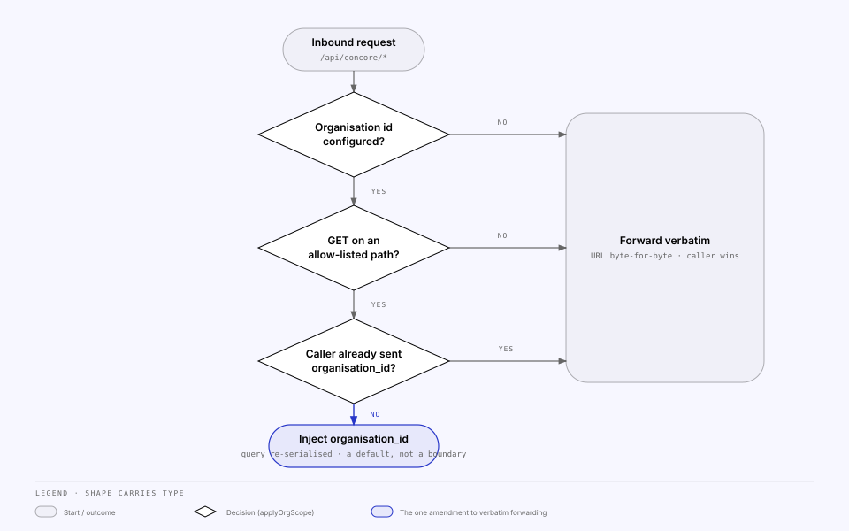

<!-- Generated from the MILS Bridge source repository (docs/integrations/concore.md). Edit it there, not here. -->

# Concore — the building-data source

Concore is Concular's building-data platform and the first `source`: its
buildings, catalog items and components get registered into MILS. The BFF
proxies its API v2 server-to-server through `apps/api/src/concore/` with a
credential the browser never sees, and applies exactly one amendment to the
forwarded requests — organisation scoping of allow-listed list reads.

## What the console configures

The Concore panel on `/integrations/concore` writes the `concore` slice
(`concoreSettingsSchema` in `packages/shared/src/settings.ts`).

| Settings field   | Env fallback         | Purpose                                                           | Read DTO exposes                                                 |
| ---------------- | -------------------- | ----------------------------------------------------------------- | ---------------------------------------------------------------- |
| `concoreBaseUrl` | `CONCORE_BASE_URL`   | API v2 base URL (must include `/api/v2`); trailing slash stripped | `concoreBaseUrl`                                                 |
| `concoreApiKey`  | `CONCORE_API_KEY`    | Sent as `X-API-Key`                                               | `hasConcoreApiKey`, `concoreApiKeyFingerprint` (stored key only) |
| `concoreOrgId`   | `CONCORE_ORG_ID`     | Sent in the org header with the key; also the scoping default     | `concoreOrgId`                                                   |
| —                | `CONCORE_TOKEN`      | Bearer token; fallback while no key is stored                     | `concoreUsesEnvBearer`                                           |
| —                | `CONCORE_ORG_HEADER` | Name of the org header (default `X-Organization-Id`)              | —                                                                |

## Credential precedence

`SettingsService.concoreAuth()` in `apps/api/src/settings/settings.service.ts`
is the single source of precedence, used by both `ConcoreClient` and the
connection test. It returns the headers to send and an `authSource` label.

| Order | `authSource`       | Condition                        | Headers sent                                                                 |
| ----- | ------------------ | -------------------------------- | ---------------------------------------------------------------------------- |
| 1     | `settings-api-key` | An API key is stored in settings | `X-API-Key: <key>` + `<CONCORE_ORG_HEADER>: <orgId>` when an org id resolves |
| 2     | `env-bearer`       | `CONCORE_TOKEN` is set           | `Authorization: Bearer <token>`                                              |
| 3     | `env-api-key`      | `CONCORE_API_KEY` is set         | `X-API-Key` + org header, as above                                           |
| 4     | `none`             | nothing configured               | no credential; the connection test refuses to probe                          |

Settings outrank the environment, mirroring MILS: `docker-compose.yml` can bake
a `CONCORE_TOKEN` default without making the panel inert.

## The pass-through and organisation scoping

`ALL /api/concore/*` (`apps/api/src/concore/concore.controller.ts`) strips
`/api/concore` and forwards through `apps/api/src/common/upstream-forwarder.ts`
with `ConcoreClient.authHeaders()` injected. Unlike MILS it passes an
`amendQuery` hook: `applyOrgScope()` from `apps/api/src/concore/org-scope.ts`.

The hook injects `?organisation_id=<configured org>` only when all four hold:
an org id is configured, the method is `GET`, the path is on the allow-list,
and the caller did not send `organisation_id` itself. Otherwise the URL is
forwarded byte-for-byte — the forwarder only re-serialises the query when the
hook returns `true`, because `URLSearchParams` would otherwise normalise
encodings on untouched routes.

Because the caller wins, this is a **default, not an authorization boundary**;
Concore still enforces access through the credential.

### The allow-list

Every Concore v2 operation whose query schema declares `organisation_id`, as a
`GET`. Patterns tolerate a missing trailing slash.

| Path                      | Method | Included                                                                                                                                             |
| ------------------------- | ------ | ---------------------------------------------------------------------------------------------------------------------------------------------------- |
| `/building/`              | GET    | yes                                                                                                                                                  |
| `/epd/specification/`     | GET    | yes                                                                                                                                                  |
| `/groups/`                | GET    | yes                                                                                                                                                  |
| `/license/`               | GET    | yes                                                                                                                                                  |
| `/public/mobile/audits/`  | GET    | yes                                                                                                                                                  |
| `/epd/specification/{id}` | DELETE | **no** — also declares the parameter, but silently scoping a destructive call changes _what gets deleted_, which is not the same as filtering a list |
| `/organisation/`          | GET    | no — scoping the organisation list by organisation would be circular                                                                                 |

The list is hand-maintained: `apps/api/src/concore/generated/` is not
committed, so the BFF has no compile-time view of the Concore spec. After a
spec refresh, re-derive it from
`apps/web/src/api/generated/concore-schema.d.ts` — see
`codegen.md`.

## Registering Concore entities

Registration snapshots the entity and creates a MILS Item; the mechanics are
in `registration-and-mapping.md`.
The Concore-specific part is the snapshot fetch: `ConcoreClient.getEntity(kind, id)`
maps each kind to a detail path and returns `null` on any non-2xx.

| `ConcoreKind`        | Detail path                  |
| -------------------- | ---------------------------- |
| `pass-catalog-item`  | `/pass-catalog-items/{id}`   |
| `auditable-item`     | `/ca/items/{id}`             |
| `building-product`   | `/building_product/{id}`     |
| `component-template` | `/components/templates/{id}` |
| `building`           | `/building/{id}`             |

`CONCORE_KINDS` (in `packages/shared/src/mapping.ts`) is the Concore-only set;
`SOURCE_KINDS` adds the other sources for anything that reads mappings. Snake
case UUIDs on the Concore side are stored as-is in `ResourceMapping.concoreId`.

## Connection test

`POST /api/integration/integrations/concore/test`
(`apps/api/src/integrations/providers/concore.provider.ts`) issues
`GET {concoreBaseUrl}/user/me` with whatever `concoreAuth()` resolved, 10 s
timeout. That endpoint accepts both credential schemes, so it validates either.
Outcomes: `401`/`403` → "rejected the credential"; `404` → the base URL lacks
`/api/v2`; a 2xx with a non-JSON body → the base URL points at a web root
(reported as a failure rather than a misleading green). On success the details
show the account label, its roles and `active_org_id`, parsed defensively from
the `MeSchema` payload so a shape drift degrades to no identity, not a 500.

The status card shows base URL, organisation, which credential resolved, and
the stored key's fingerprint. `configSource` is `settings` for a stored key,
`env` for either environment fallback, `none` otherwise.

## Related

- [`mils.md`](mils.md) — the target these entities are registered into.
- [`configuration.md`](configuration.md) — the `CONCORE_*` variables.
- [`runbooks.md`](runbooks.md) — `register:concore-item`, `import:concore-catalog`.
