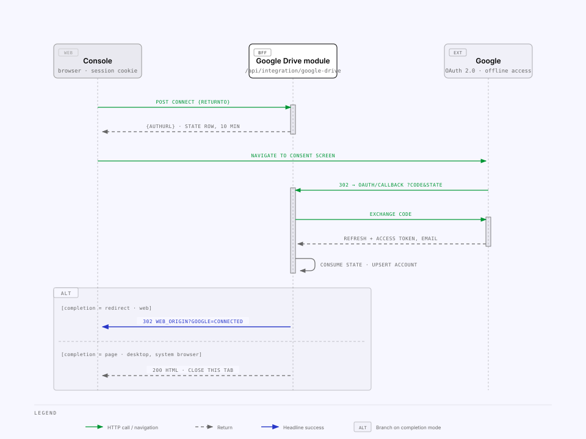
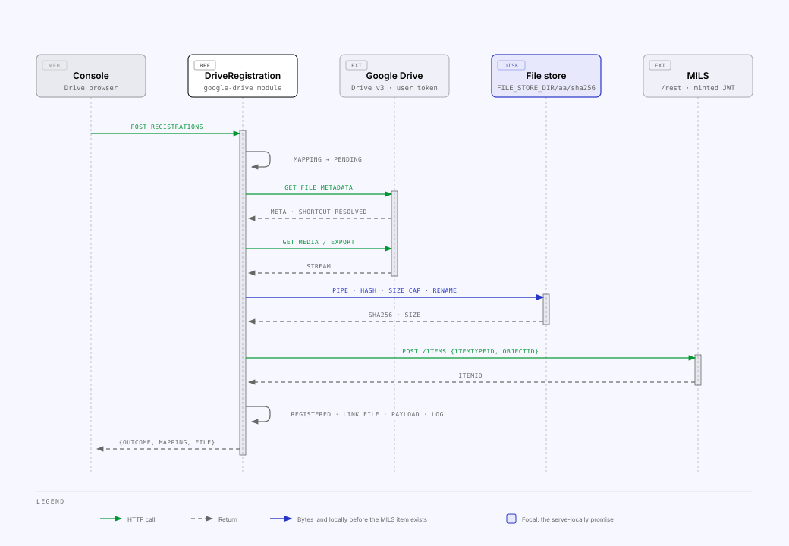

<!-- Generated from the MILS Bridge source repository (docs/integrations/google-drive.md). Edit it there, not here. -->

# Google Drive — the per-user file source

Console users connect **their own Google account**, browse their Drive through
the BFF and register a file into MILS. Registration copies the bytes into the
BFF's local file store; from then on the item's content is served from that
copy and never fetched from Drive again. This is the one integration with a
per-user connection (`perUserConnection: true` in the registry).

## One-time Google Cloud setup

1. Create (or pick) a Google Cloud project and **enable the Google Drive API**.
2. **OAuth consent screen** → user type **Internal** (the Workspace org).
   Scopes, as requested by `GOOGLE_SCOPES` in
   `apps/api/src/google-drive/google-oauth.service.ts`: `openid`,
   `…/auth/userinfo.email`, `…/auth/drive.readonly`. `drive.readonly` is a
   _restricted_ scope — an Internal app needs no Google verification for it;
   switching to External triggers the verification process.
3. **Credentials → OAuth client ID → Web application**, with one authorized
   redirect URI per environment the BFF runs at:

   | Environment | Redirect URI                                                                   |
   | ----------- | ------------------------------------------------------------------------------ |
   | dev         | `http://localhost:8080/api/integration/google-drive/oauth/callback`            |
   | prod        | `https://bridge.example.com/api/integration/google-drive/oauth/callback` |
   | desktop     | `http://localhost:47800/api/integration/google-drive/oauth/callback`           |

4. Enter client id, client secret and _this_ BFF's redirect URI on
   `/integrations/google-drive`, or seed them via `GOOGLE_CLIENT_ID`,
   `GOOGLE_CLIENT_SECRET`, `GOOGLE_REDIRECT_URI`. Settings outrank env, per
   field (`SettingsService.googleOAuth()`).

## What the console configures

The `google-drive` slice (`googleDriveSettingsSchema` in
`packages/shared/src/settings.ts`) is the OAuth **app**; per-user tokens are
not settings.

| Settings field       | Env fallback           | Read DTO exposes                                           |
| -------------------- | ---------------------- | ---------------------------------------------------------- |
| `googleClientId`     | `GOOGLE_CLIENT_ID`     | `googleClientId` (effective), truncated on the status card |
| `googleClientSecret` | `GOOGLE_CLIENT_SECRET` | `hasGoogleClientSecret`, `googleClientSecretFingerprint`   |
| `googleRedirectUri`  | `GOOGLE_REDIRECT_URI`  | `googleRedirectUri` (effective)                            |

## How it fits together

| Piece               | Where                                                                                     | Notes                                                                                              |
| ------------------- | ----------------------------------------------------------------------------------------- | -------------------------------------------------------------------------------------------------- |
| OAuth app           | `IntegrationSettings.google*`, env fallback                                               | Rebuilt into an `OAuth2Client` per call — a Settings change needs no restart                       |
| Per-user connection | `GoogleAccount` (1:1 with `User`)                                                         | Refresh + access token, scopes, `needsReconnect`. Tokens never reach the browser                   |
| OAuth `state`       | `GoogleOAuthState`                                                                        | Random, single-use, 10-minute TTL, bound to the user id; the callback does **not** need the cookie |
| Drive access        | `apps/api/src/google-drive/google-drive.client.ts`                                        | Drive v3 over axios as the user; one `401` → forced token refresh → retry                          |
| Local blobs         | `FILE_STORE_DIR/<aa>/<sha256>` via `apps/api/src/file-store/file-store.service.ts`        | Content-addressed; streamed into `tmp/` then renamed; size cap enforced while streaming            |
| Blob metadata       | `StoredFile`                                                                              | Name, mime, size, sha256, Drive id / md5 / revision, `milsItemId`, `mappingId`                     |
| Cross-reference     | `ResourceMapping` with `concoreKind = 'google-drive-file'`, `concoreId = <Drive file id>` | Same table as every source, so one MILS item maps once across sources                              |

## Endpoints

All under `/api/integration/google-drive`, guard `session` (`AuthGuard`) except
the callback. Not part of the public integration OpenAPI document.

| Method | Path                                                                     | Guard   | Purpose                                                                                                                                                                                             |
| ------ | ------------------------------------------------------------------------ | ------- | --------------------------------------------------------------------------------------------------------------------------------------------------------------------------------------------------- |
| GET    | `connection`                                                             | session | `{ connected, email, scopes, connectedAt, needsReconnect, appConfigured }`                                                                                                                          |
| POST   | `connect` `{ returnTo?, completion? }`                                   | session | Mints a state row, returns `{ authUrl }`; the browser navigates there top-level. `returnTo` must be a relative console path                                                                         |
| GET    | `oauth/callback?code&state`                                              | none    | Consumes the state, exchanges the code, upserts `GoogleAccount`, then `302 <WEB_ORIGIN><returnTo>?google=connected\|error&reason=…` — or, for `completion=page`, a standalone "close this tab" page |
| DELETE | `connection`                                                             | session | Revoke at Google (best-effort) and forget the account                                                                                                                                               |
| GET    | `files?folderId&q&pageToken&pageSize`                                    | session | Folder listing (shared drives appear as folders at the root) or Drive-wide name search; each row carries its local `mapping`                                                                        |
| GET    | `files/:fileId`                                                          | session | Metadata + `storedFile` + `isStale`                                                                                                                                                                 |
| POST   | `registrations` `{ fileId, milsObjectId, itemTypeId, parentMappingId? }` | session | Register into MILS (below)                                                                                                                                                                          |
| POST   | `files/:fileId/resync`                                                   | session | Re-download when Drive changed or the blob is missing; `outcome` is `unchanged`, `updated` or `restored`                                                                                            |

`WEB_ORIGIN`'s first entry is the redirect base — never derived from the
request.

### Connecting

Errors never surface as bare JSON: the callback reports `invalid_state`
(expired or reused), `missing_code`, `exchange_failed` or Google's own error
through the `reason` query parameter so the console can show them.

### Serving the bytes

Never from Drive:

| Route                                                                     | Guard                                         | Notes                                                                                              |
| ------------------------------------------------------------------------- | --------------------------------------------- | -------------------------------------------------------------------------------------------------- |
| `GET /api/integration/files` · `/:milsId` · `/:milsId/content?download=1` | session or actor JWT + `ElementAccessGuard`   | `apps/api/src/file-store/files.controller.ts`; the descriptor and the bytes are both element reads |
| `GET /rest/MilsItems/:id/ItemFile`                                        | none (`ElementRefGuard` for attribution only) | `ItemData` for the same item returns the `StoredFileDto` descriptor                                |

`apps/api/src/file-store/send-stored-file.ts` sets `ETag = "<sha256>"`,
answers `If-None-Match` with `304`, `410 Gone` when the blob is missing on
disk, and forces `Content-Disposition: attachment` for `text/html` and
`image/svg+xml`.

## Registration

`DriveRegistrationService.register()` in
`apps/api/src/google-drive/drive-registration.service.ts` mirrors the Concore
flow step for step — PENDING row first, then REGISTERED/FAILED, always a
`RegistrationLog` — with one ordering rule: **the bytes land in the store
before the MILS item is created**. An item without a local copy would break
the serve-locally promise, whereas an orphan blob is harmless (`files:gc`).

| Step                                                                                  | On failure                                                                 |
| ------------------------------------------------------------------------------------- | -------------------------------------------------------------------------- |
| Existing `REGISTERED` mapping for the file id                                         | → `EXISTS`; a lost `StoredFile` row is restored without a second MILS item |
| Drive metadata (shortcuts resolve to their target)                                    | folder or native type without export → `400`                               |
| Mapping `PENDING` (snapshot = Drive metadata)                                         |                                                                            |
| Download / export into the file store                                                 | mapping `FAILED` + log, `502`                                              |
| `POST /Items` on MILS                                                                 | mapping `FAILED` + log, `502`                                              |
| Mapping `REGISTERED`, `StoredFile` linked (`milsItemId`, `mappingId`, `registeredBy`) |                                                                            |
| `MilsItemPayload := StoredFileDto`                                                    | best-effort; `payloadStored: false` in the log                             |
| `RegistrationLog REGISTER/SUCCESS { milsId, sha256, size, payloadStored }`            |                                                                            |

Re-sync (`resync`) re-downloads when the md5 / revision / modified time moved
or the blob is missing, keeps the MILS item, refreshes the payload descriptor,
drops the superseded blob when nothing else references it, and logs an
`UPDATE`.

### Google-native files

Docs, Sheets and Slides have no bytes of their own; they are exported with a
fixed format from `EXPORT_MIME` in `apps/api/src/google-drive/drive-export.ts`,
and the file name gets the matching extension when it lacks one.

| Drive type                       | Stored as                                           |
| -------------------------------- | --------------------------------------------------- |
| Document, Presentation, Jamboard | `application/pdf`                                   |
| Spreadsheet                      | `.xlsx` (`…spreadsheetml.sheet`)                    |
| Drawing                          | `image/png`                                         |
| Apps Script                      | `application/vnd.google-apps.script+json`           |
| Forms, Sites, Maps, …            | shown, **not registrable** (`exportMimeType: null`) |

Google caps exports at 10 MB.

## Connection test

`POST /api/integration/integrations/google-drive/test`
(`apps/api/src/integrations/providers/google-drive.provider.ts`) has three
outcomes, because the app is node-wide but the token belongs to the caller:

| `authSource` | Meaning                                                                                                         | `ok`  |
| ------------ | --------------------------------------------------------------------------------------------------------------- | ----- |
| `none`       | Client id, secret or redirect URI missing — nothing can be tested                                               | false |
| `app-only`   | App configured, the calling user has no Google account connected                                                | true  |
| `user-token` | The caller's token was used against Drive `about.get` (one `401` → refresh → retry); the account email is shown | 2xx   |

## Related

- [`mils-internal-api.md`](mils-internal-api.md) — `ItemData` / `ItemFile` for a registered file.
- [`runbooks.md`](runbooks.md) — `files:verify`, `files:gc`, `reconcile`.
- [`troubleshooting.md`](troubleshooting.md) — redirect mismatch, invalid state, `409` expired grant, `410` missing blob, `disallowed_useragent`.
- [`security.md`](security.md) — plaintext tokens at rest, the unauthenticated `ItemFile`, hash-only blob paths.
- [`configuration.md`](configuration.md) — `GOOGLE_*`, `FILE_STORE_*`.
