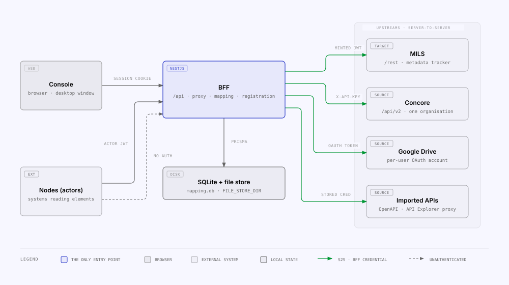

# MILS Bridge

The MILS Bridge registers the things your organisation already has — Concore
entities, files from Google Drive, Microsoft 365 and Amazon S3, rows from SQL
databases and Notion, records other systems push to it, CSV and JSON files,
responses from any HTTP API you import, files from your own computer and typed
JSON values — as **items in MILS**, keeps the
durable cross-reference between the two, and serves those items back to the
peer nodes that ask for them. It is one container: a server that talks to the
upstream systems for you, and a web console that talks only to that server.

It is for an organisation that runs a MILS node: you decide what gets
registered, which peers may read which elements, and what your node answers
when another node asks.



## Start here

| If you want to…                              | Read                                                                                                     |
| -------------------------------------------- | -------------------------------------------------------------------------------------------------------- |
| Understand what the bridge does and why      | [What this is](what-this-is.md) · [Glossary](glossary.md)                                                |
| Run a node                                   | [Deployment](deployment.md) · [Configuration](configuration.md)                                          |
| Connect MILS and the sources you register from | [MILS](mils.md) · [Concore](concore.md) · [Google Drive](google-drive.md) · [Microsoft 365](microsoft-365.md) · [Amazon S3](s3.md) · [SQL](sql.md) · [Notion](notion.md) · [Inbound push](push.md) · [Bulk import](bulk-import.md) · [API Explorer](api-explorer.md) · [Local elements](local-elements.md) |
| Decide who may read what                     | [Access control](access-control.md) · [Security](security.md)                                            |
| Connect another node, or connect to one      | [Peer node quickstart](peer-node-quickstart.md) · [Peer node onboarding](peer-node-onboarding.md)        |
| Implement the contract peers call            | [The `/rest` API](mils-internal-api.md) · [OpenAPI contract](api-reference.md)                           |
| Operate it day to day, or fix something      | [Runbooks](runbooks.md) · [Troubleshooting](troubleshooting.md)                                          |

## Quickstart

```bash
git clone https://github.com/Concular/mils-bridge && cd mils-bridge
cp .env.example .env         # set MILS_ACTOR_CODE_SELF and MILS_BASE_URL
docker compose up -d         # pulls ghcr.io/concular/mils-bridge
docker compose logs -f bridge
```

Then open <http://localhost:8080>. The first visit lands on `/setup`: the
account you create there is the node's first administrator. After that, go to
**Integrations** and connect MILS — a signing key on the MILS panel is what
lets this node create items.

!!! warning "Set `MILS_ACTOR_CODE_SELF`"

    It is **your** MILS ActorCode. Left unset it falls back to a default, and
    every token this node signs then claims to be that actor. The bridge logs a
    warning at boot if you leave it.

The quickstart publishes port 8080 on loopback only, so nothing is reachable
from the network yet. Peers can read from this node once it is behind a domain
with TLS — see [Deployment](deployment.md).

## Three decisions every deployment makes

| Decision                    | Where                                                                                            |
| --------------------------- | ------------------------------------------------------------------------------------------------ |
| Who this node is            | `MILS_ACTOR_CODE_SELF`, plus an RS256 signing key on the MILS settings panel                     |
| Who may read what           | `ACCESS_ENFORCEMENT` (`shadow` → `enforce`) and `MILS_INTERNAL_AUTH` — [Access control](access-control.md) |
| Whether secrets are at rest | `SECRETS_KEY` — with it set, the stored credentials are encrypted in SQLite                      |

`ACCESS_ENFORCEMENT` ships as `shadow`: rules are evaluated and recorded, and
nothing is refused. Watch the denial counts on **Access → Statistics** until
they are what you expect, then switch to `enforce`
([Runbooks](runbooks.md#roll-out-access-enforcement-shadow-to-enforce)).

## Releases

Images are published as `ghcr.io/concular/mils-bridge`; set the tag you want as
`BRIDGE_VERSION` in `.env` and pin an exact release on anything you care about.
Releases and their changelogs are on the repository's
[Releases](https://github.com/Concular/mils-bridge/releases) page. A change to
the [peer contract](api-reference.md) that peers must follow bumps the major
version and says so in the release title.

Questions and bug reports: the repository's
[issues](https://github.com/Concular/mils-bridge/issues).
