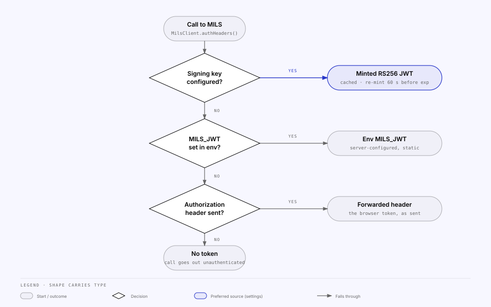

<!-- Generated from the MILS Bridge source repository (docs/integrations/mils.md). Edit it there, not here. -->

# MILS — the target

MILS is the metadata tracker every source registers into, and the only
integration with the `target` role. The BFF reaches it server-to-server through
`apps/api/src/mils/mils.client.ts`, which owns the base URL and the bearer
token so that neither the pass-through controller nor the registration services
deal with authentication.

## What the console configures

The MILS panel on `/integrations/mils` writes the `mils` settings slice
(`milsSettingsSchema` in `packages/shared/src/settings.ts`) through
`PUT /api/integration/integrations/mils/settings`. Every field is optional:
an absent field keeps the stored value, an empty string clears it and falls
back to the environment.

| Settings field                             | Env fallback                    | Purpose                                                                                                                                                                                    | Read DTO exposes                                           |
| ------------------------------------------ | ------------------------------- | ------------------------------------------------------------------------------------------------------------------------------------------------------------------------------------------ | ---------------------------------------------------------- |
| `milsBaseUrl`                              | `MILS_BASE_URL`                 | Origin + `/rest`; trailing slash stripped                                                                                                                                                  | `milsBaseUrl` (effective value)                            |
| `selfActorCode`                            | `MILS_ACTOR_CODE_SELF` → `conc` | **This node's own `ActorCode`** — the identity, see below                                                                                                                                  | `selfActorCode`, `selfActorCodeSource`, `inboundAudiences` |
| `selfNodeId`                               | —                               | Our own `NodeId`, purely as a cross-check on the code above                                                                                                                                | `selfNodeId`                                               |
| `signingKeyPem`                            | —                               | RS256 private key, PEM; enables minting                                                                                                                                                    | `hasSigningKey`, `signingKeyFingerprint`                   |
| `signingKeyPassphrase`                     | —                               | Passphrase for an encrypted PEM (`ENCRYPTED PRIVATE KEY`)                                                                                                                                  | `hasSigningKeyPassphrase`                                  |
| `jwtIssuer` / `jwtSubject` / `jwtAudience` | —                               | `iss` / `sub` / `aud` claims. `sub` defaults to `selfActorCode`; `aud` is for **upstream MILS only** and defaults to `mils-rest-api` — peers get their own audience from the node registry | same names                                                 |
| `jwtKeyId`                                 | —                               | `kid` header on the minted token                                                                                                                                                           | `jwtKeyId`                                                 |
| `jwtTtlSeconds`                            | —                               | Token lifetime, 60–86 400 s; default 3600                                                                                                                                                  | `jwtTtlSeconds`                                            |
| —                                          | `MILS_JWT`                      | A static server token used only when no signing key is stored                                                                                                                              | `configSource: env` on the integration status              |

### This node's MILS identity

`selfActorCode` is not a label — it is which actor this deployment **is** in the
MILS network, and two things follow from it:

- the names we accept on an inbound token (`<code>-rest-api` and
  `<code>-mils-api` — the audience names the recipient), which the panel shows
  live as the field is typed, because a mistake here is a 401 for every peer
  that addresses us;
- the `sub` we stamp on every outbound token, so a blank JWT-subject field
  means "send who we are" rather than "send no `sub`".

What does **not** follow from it is the audience we stamp **outbound**: that is
the _recipient's_ — `mils-rest-api` for MILS (the _Audience for MILS_ field on
this page overrides it), and each peer's own from its registry row
(`<owner actor code>-mils-api`, or the override stored under _Access → Nodes_).

It defaults to `conc`, Concular's own MILS actor, so a **fork or white-label
deployment must change it**. Neither it nor the derived names are secrets, so
all are returned plainly. The resolution ladder, and why the identity is
configured rather than read back from the node registry, are in
[`actors-and-nodes.md`](actors-and-nodes.md).

Secrets are write-only: `SettingsService.get()` in
`apps/api/src/settings/settings.service.ts` returns booleans and a 16-hex-char
SHA-256 fingerprint, never the key or passphrase. `SettingsService.update()`
records an `AuditEvent` naming the changed _fields_ (see
`dashboard-audit-statistics.md`).

## Bearer token precedence

Every call resolves its `Authorization` header at request time in
`MilsClient.authHeaders()`; nothing is cached across settings changes except
the minted token itself.

| Order | Source                                   | When it applies                                                            | Code                                                       |
| ----- | ---------------------------------------- | -------------------------------------------------------------------------- | ---------------------------------------------------------- |
| 1     | JWT minted from the stored signing key   | `signingKeyPem` is set                                                     | `MilsTokenService.getToken()`                              |
| 2     | `MILS_JWT` from the environment          | No signing key stored                                                      | `SettingsService.envJwt()`                                 |
| 3     | The browser's own `Authorization` header | Neither of the above; only the `/api/mils/*` pass-through forwards one     | `MilsController.proxy()` passes the inbound header through |
| 4     | No header                                | Nothing resolved — the upstream answers `401`, which is forwarded verbatim | —                                                          |

Settings outrank the environment on purpose: a deployment that bakes `MILS_JWT`
into its compose file would otherwise make the panel inert.

### Minting and caching

`apps/api/src/settings/mils-token.service.ts` signs `{ iss?, sub?, aud }` with
`RS256`, `expiresIn = jwtTtlSeconds` and an optional `keyid`. The key is loaded
with `crypto.createPrivateKey` first — with `{ key, passphrase }` for an
encrypted PEM — so a bad key or passphrase fails with a precise message rather
than jsonwebtoken's misleading "must be an asymmetric key".

Tokens are cached until 60 seconds before `exp`, keyed by a SHA-256 of key +
passphrase + claims + audience, so changing any of them re-mints on the next
call with no explicit invalidation. The cache is keyed by audience and holds
**one entry per recipient**: `aud` names the recipient, so `milsToken()` is
`tokenFor(milsAudience())` (`mils-rest-api`, or the Settings override) and the
peer probe and both federated legs call `tokenFor(<that peer's audience>)` —
the row's `audienceOverride`, else `<owner actor code>-mils-api`.

## The pass-through

`GET|POST|… /api/mils/*` is one `@All('*')` handler in
`apps/api/src/mils/mils.controller.ts` that strips `/api/mils` and replays path
and query byte-for-byte against `milsBaseUrl()` via
`apps/api/src/common/upstream-forwarder.ts`. The upstream status, content type
and body come back unchanged (`validateStatus: () => true`), errors included.
No `amendQuery` hook is used for MILS; the URL is never re-serialised. The
route is unguarded at the BFF — MILS authenticates the bearer it receives — and
excluded from the Swagger document (`@ApiExcludeController`).

## Direct calls the BFF makes

Registration services do not go through the pass-through; they call
`MilsClient` methods that always carry the resolved bearer:

| Method                                 | MILS call                                           | Used by                                                                                                           |
| -------------------------------------- | --------------------------------------------------- | ----------------------------------------------------------------------------------------------------------------- |
| `createItem({ ItemTypeId, ObjectId })` | `POST /Items` → returns the new id under `ObjectId` | every registration service (`registration-and-mapping.md`) |
| `getItem(id)`                          | `GET /Items/{id}` (`null` on non-200)               | `reconcile` script                                                                                                |
| `deleteItem(id)`                       | `DELETE /Items/{id}`                                | no caller today — mapping archive is local to the BFF                                                             |
| `reactivateItem(id)`                   | `POST /Items/{id}/Reactivate`                       | no caller today                                                                                                   |

## GUID brace rule

MILS bodies carry braced GUIDs (`{1b7ca2a4-…}`); path parameters take the bare
uuid. `apps/api/src/common/mils-ids.ts` is the server-side rule:
`normalizeMilsId()` strips braces, lower-cases and validates (a `400` on
anything that is not a uuid), `toBracedMilsId()` wraps for a body, and
`MilsClient` unbraces before building `/Items/{id}` paths. Ids are stored
unbraced and lower-cased. The console has the same pair in
`apps/web/src/lib/ids.ts` — see
`web-console.md`.

## List envelope

List reads answer `{ AvailableRowCount, <Resource>: [...] }`, not a bare array;
`AvailableRowCount` is the total matching count independent of paging
(`MaxRowCount` / `SkipRowCount`). The BFF forwards that shape untouched; the
console unwraps it in `apps/web/src/api/list-envelope.ts`. Detail reads return
the entity directly.

## Connection test

`POST /api/integration/integrations/mils/test` runs
`apps/api/src/integrations/providers/mils.provider.ts`: it resolves the token
exactly as `MilsClient` would (reporting `authSource` as `minted`, `env`,
`none`, or `error` when a stored key cannot be loaded — in which case no
upstream call is made), then issues `GET {milsBaseUrl}/Countries?MaxRowCount=1`
with a 10 s timeout. `ok` is a 2xx; `401`/`403` is reported as "MILS rejected
the token". The panel's _Save & test_ persists first, then probes — the probe
never reads unsaved form state. The same result feeds the dashboard's
connection pill, so the two cannot disagree.

The integration status card shows: base URL, auth source (`Minted JWT · kid …`
or `Server env MILS_JWT`), key fingerprint, issuer and audience. `configured`
is true when either a signing key or `MILS_JWT` exists.

## Related

- [`concore.md`](concore.md) — the first source; same settings-over-env rule.
- [`configuration.md`](configuration.md) — `MILS_BASE_URL`, `MILS_JWT` and the rest of the environment.
- [`runbooks.md`](runbooks.md) — `load:signing-key` loads a PEM (+ passphrase) into the settings row from the CLI.
